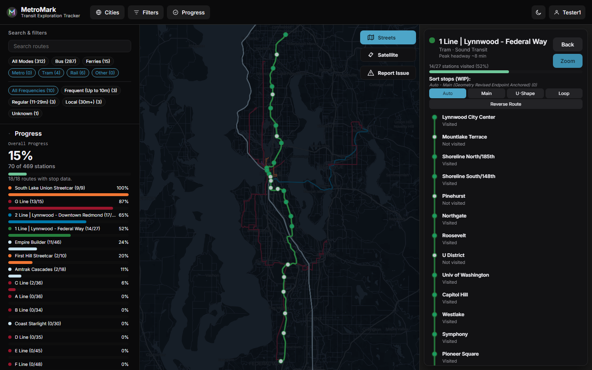
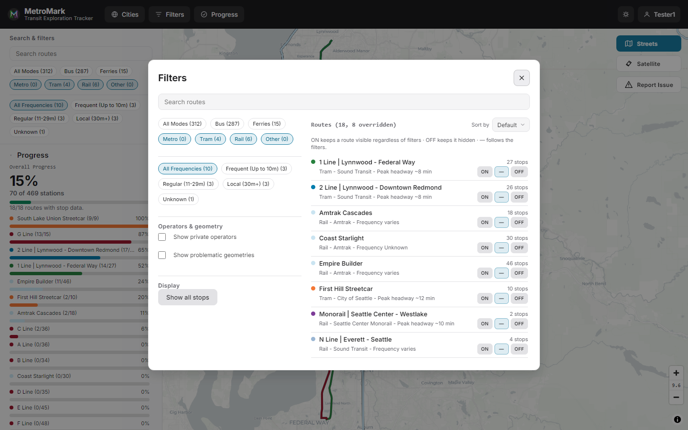
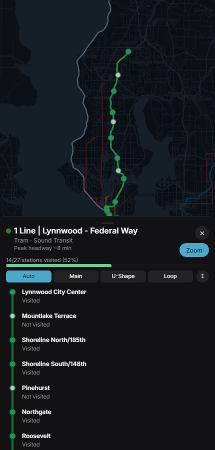

# MetroMark

MetroMark is a Transit Exploration Tracker, showing public transportation routes from around the
world on an interactive map, and allowing users to mark their progress as they visit stations
along each line.

MetroMark works on all platforms, try it out at [metromark.app](https://metromark.app).

## Contents

- [The map](#the-map)
- [Filters and presets](#filters-and-presets)
- [Line view](#line-view)
- [Branches and stop order](#branches-and-stop-order)
- [Progress](#progress)
- [Cities](#cities)
- [Missing routes](#missing-routes)
- [Corrected and merged data](#corrected-and-merged-data)
- [On mobile](#on-mobile)
- [Data and attribution](#data-and-attribution)
- [For developers](#for-developers)

## The map

The map draws the routes loaded for the current area, in the colors used by each agency. It covers
bus, tram, metro, rail, ferry, cable tram, aerial lift, funicular, trolleybus and monorail.

The route list shows each line's operator, mode, peak headway and number of stations. Selecting a
line brings it forward: the rest of the map dims, and the line view opens. The selected line stays
drawn above the dimmed map, so it remains readable in dense areas.

At very wide zoom levels the map stops loading new areas. Lines already on screen stay visible.

## Filters and presets

The mode filters are All Modes, Bus, Ferries, Metro, Tram and Rail. Monorail is grouped under
Rail; cable tram, aerial lift and funicular are under Other.

The frequency filter uses All Frequencies, Frequent (up to 10m), Regular (11-29m), Local (30m+) and
Frequency Unknown.

Each line in the list has a three-state visibility control: ON keeps it visible, OFF hides it, and
the dash follows the filters. ON and OFF are saved per line and survive reloads. Private operators
and lines with broken map geometry can be hidden from the filter panel.

Filter presets save modes, frequencies, search text and line visibility under a name, so a setup
can be restored later.

Search filters the line list. It also searches lines outside the current view; those results are
marked "Not in view", and choosing one moves the map to that line.

## Line view

Selecting a line opens the line view: a side panel on desktop and a bottom sheet on mobile.

- Header: line color, name, mode/operator, peak headway, and visited/total stations with a
  progress bar.
- Zoom fits the line on screen. Back closes the line view.
- Stop order: Auto, Main, U-Shape, Loop and Reverse, for lines whose stop sequence does not match
  the way the line is drawn. If a maintainer has set a manual order, the order buttons are
  replaced by a note and the list follows that order.
- Stops: visited stops are marked in the list. Tapping a stop on the map or in the line view
  toggles it. The connector line runs through the stop list. Show all stops keeps stops visible
  for every line, not just the selected one.
- Suggest changes: propose a mode and/or a stop ordering (No Suggestion, Auto, Main, U-Shape, Loop,
  Request Manual Review) and add a note for a maintainer.
- Clear progress: resets visited stops for the line; a second click confirms.

## Branches and stop order

Maintainers can define branch groups with named options for lines that split. The line view then
shows one branch selector row per group, with a button per option.

Stops on the selected option and the shared trunk are shown; stops on other options are hidden. A
stop can belong to more than one option, which covers lines where branches share a section (the
Northern line's High Barnet and Mill Hill East services, for example). The first stop of a branch
and the stop where it rejoins the trunk get split labels ("Branches to ..." and "... rejoins").

## Progress

Sign in to record visited stops. A display name is required at registration and is what appears in
the profile button.

Tap a stop on the map or in the line view to mark it visited. Progress is counted per line and
overall, and shown in the progress panel and in each line view. Taps made offline are saved and
sent when the connection returns. Progress can be cleared per line from the line view, with a
confirmation click.

The profile menu holds the account options and Colorblind mode. Advanced information (data usage,
app version and related links) is in the sidebar on desktop and in the layers sheet on mobile.

## Cities

City presets are curated by maintainers. Each preset lists the operators and lines that belong to a
city, any exclusions, and review flags for accuracy, up-to-date status and stop order.

Opening a city from the Cities menu limits the map to that city's lines, fits the view, and
remembers the last city. Globe View shows everything and lets you explore anywhere. City presets
are loaded ahead of time, so their routes are ready when you open them.

## Missing routes

When an area is missing lines, MetroMark fetches them automatically and updates the map. A loading
card or the corner badge shows progress; no action is needed.

Large cities may take several passes; each pass continues where the last one stopped. Wide zoom
levels pause loading.

## Corrected and merged data

Transit data is not always right. Maintainers can fix a line's name, color, mode, frequency and
stop order; add or remove stops; rename or move stops; and define branches. Duplicate lines are
merged when their stops and paths match; lines with conflicting details are combined under one
name.

Suggestions from the line view are reviewed by maintainers. Fixes and merges apply as soon as the
line loads, without waiting for the map to rebuild. Lines with broken geometry can be flagged and
hidden by default.

## On mobile

The mobile layout has bottom tabs for Map, Cities, Filters and Progress.

The line view is a swipeable bottom sheet: peek for the summary, half for stops and stop order,
full for long lines. Filters and map layers open as sheets. The map toolbar has streets/satellite,
report issue and recenter.

MetroMark installs as an app, and progress made offline syncs when the connection returns.

## Data and attribution

Transit data comes from [Transitland](https://www.transit.land/). Map tiles are from OpenStreetMap
contributors and CARTO, rendered with MapLibre GL. See
[Transitland's terms](https://www.transit.land/terms).

## For developers

Self-hosting, the admin console, the map editor and override workflows are in the
[Operations Guide](docs/OPERATIONS_GUIDE.md). System design is in
[Architecture](docs/ARCHITECTURE.md).
