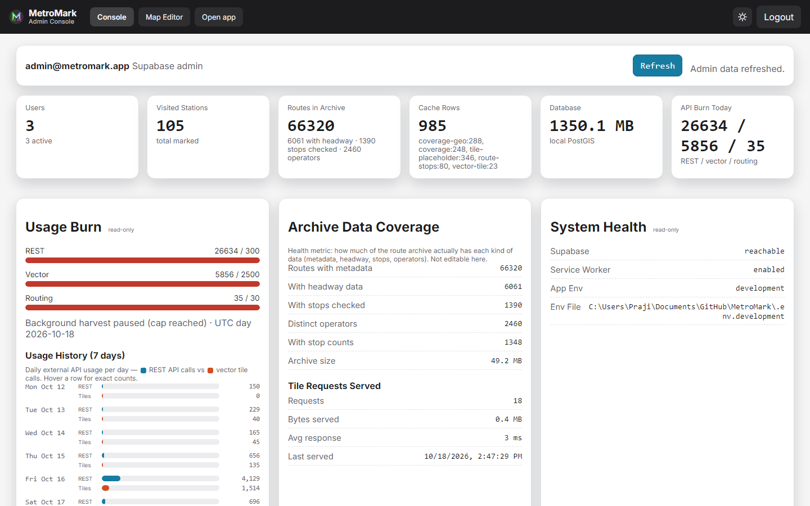
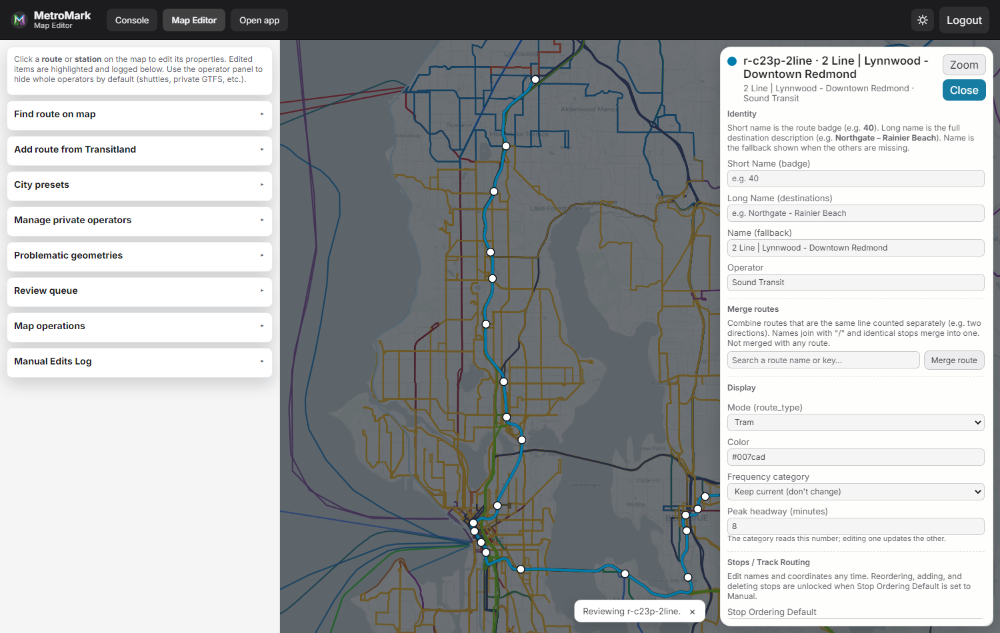

# Operations Guide

Self-hosting, maintenance, and admin workflows for MetroMark. System design is in
[Architecture](ARCHITECTURE.md).

## Contents
- [Running it yourself](#running-it-yourself)
- [Login model](#login-model)
- [Admin console](#admin-console)
- [Manual override editor](#manual-override-editor)
- [User preferences](#user-preferences)
- [Transit data and cleanup](#transit-data-and-cleanup)
- [Review and filtering notes](#review-and-filtering-notes)
- [Operational notes](#operational-notes)
- [Production Deployment (Windows 11)](#production-deployment-windows-11)
- [Windows Host Operation (bat-based)](#windows-host-operation-bat-based)
- [Production Readiness Checklist](#production-readiness-checklist)

## Running it yourself
1. Install Node.js 20+.
2. Copy `.env.development.example` to `.env.development` and add your Supabase keys and a
   Transitland API key.
3. Apply the Supabase SQL in the dashboard:
   `operations/sql/supabase-baseline.sql` and `operations/sql/supabase-changes.sql`.
4. Install and run:
   ```bash
   npm install
   npm run start:dev
   ```
5. Open http://localhost:8080.

Production uses `.env.production` and `npm run start:prod`; see
[Production Deployment](#production-deployment-windows-11).

## Login model
- Admin console and manual override editor both require a session login.
- Login uses the Supabase account whose email matches `ADMIN_EMAIL` (the bootstrap admin, granted the admin role on login); the password lives in Supabase, not the env.
- The browser stores the admin session token in `sessionStorage`, not `localStorage`.
- Reopen the browser or tab to require a fresh login.

## Admin console
- `/admin` is the main maintenance hub.
- It exposes usage, cache, harvest, and database status.
- It links to `/admin/override` for route cleanup work.
- Protected admin actions are accepted only when the request includes the active admin session or a signed-in Supabase admin user.



## Manual override editor
- `/admin/override` loads the selected route and its current cached Transitland geometry/stops.
- Route loading is cache-first through the transit API, with Transitland fallback when needed.
- The editor supports:
  - changing agency, mode, and frequency
  - adding stops
  - deleting stops
  - moving stops up and down
  - renaming stops
  - editing stop coordinates
  - resetting the working copy from the live route payload
- Route overrides are stored in `public.route_override`, so they survive cache refreshes.



## User preferences
- Per-user UI settings (filters, display and accessibility toggles such as Colorblind mode)
  live in the single `public.profiles.preferences` JSON object in Supabase.
- Adding a new preference toggle needs no SQL migration: the API merges the new key into the
  existing object, and the nonrecoverable backup includes `preferences` wholesale.
- Signed-out users get a localStorage mirror of the same keys.

## Transit data and cleanup
- Transit cache and route geometry live in local Postgres/PostGIS.
- User auth and user preferences live in Supabase.
- Refreshing a city or clearing transit caches does not remove manual route overrides.
- Keep the cleanup scripts in `tools/` for Supabase purge and local transit reset workflows.

## Review and filtering notes
- Agency review uses a tri-state model:
  - `true` = approved
  - `false` = blocked
  - `null` = unreviewed
- Unreviewed agencies stay visible until they are explicitly reviewed.
- Problematic geometry review should remain a separate route-level review flag.

## Operational notes
- Use the admin console to inspect API usage and harvest progress before forcing a refresh.
- If a route edit is wrong, re-open the editor, load the route again, and adjust the override payload instead of manually editing tables.
- Manual route override payloads should stay JSON-friendly and small enough to review by eye.

## Production Deployment (Windows 11)
- Two env profiles: `.env.development` and `.env.production`.
- Start: `npm run start:dev` / `npm run start:prod`.
- Operational jobs: `npm run harvest:world`, `npm run harvest:headway`, `npm run harvest:stops`, `npm run backup:nonrecoverable` (or the `operations/run-harvesters.bat` loop).
- Use separate Supabase projects for dev and production.
- Local Postgres schema is auto-provisioned at server startup; Supabase schema is applied from `operations/sql/supabase-baseline.sql` in the Supabase dashboard.

## Windows Host Operation (bat-based)
- Start at login: put a shortcut to `operations\start-metromark.bat` in the Startup folder (`Win+R` → `shell:startup`), or add a Task Scheduler task (trigger: At startup; "restart on failure") for crash recovery.
- `start-metromark.bat` starts the web app (Express server) and the harvester loop (`operations\run-harvesters.bat`: world + headway + stops, daily-quota-aware). It does **not** touch GitHub.
- **GitHub updates are manual**: run `operations\sync-from-github.bat` when you want to pull the latest stable code. It self-locates the repo (or clones it fresh) and works on any PC, including a spare running an old version — copy the bat over and run it.
- **`data/` is gitignored and per-machine** — it is never synced by git or the update bat (its `git reset --hard` only touches tracked files). Each machine builds its own tiles/NDJSON through the harvesters; copy `data/` manually if you ever want to seed a machine.
- **Backups are automatic** (once per UTC day): `run-harvesters.bat` calls `operations\maybe-backup.bat`, which runs the nonrecoverable backup guarded by a date marker. You can also trigger manually from the admin dashboard ("Run Nonrecoverable Backup") or `npm run backup:nonrecoverable:prod`.
- **Daily restart** (optional, for log rollover + process hygiene): run `operations\install-daily-restart.bat` once as admin to register a Task Scheduler task that calls `restart-metromark.bat` each morning. `restart-metromark.bat` can also be run by hand after a `sync-from-github.bat`.

## Production Readiness Checklist
1. Populate `.env.production` with real production keys.
2. Apply SQL migration on production Supabase.
3. Run `npm install` once.
4. Verify account register/login and progress write/read.
5. Run one manual harvest and one backup.
6. Verify `/admin` values.
7. Add `operations\start-metromark.bat` to Startup (or a Task Scheduler task).
8. Confirm `start-metromark.bat` starts the app + harvester loop, and that the dashboard backup button works.
